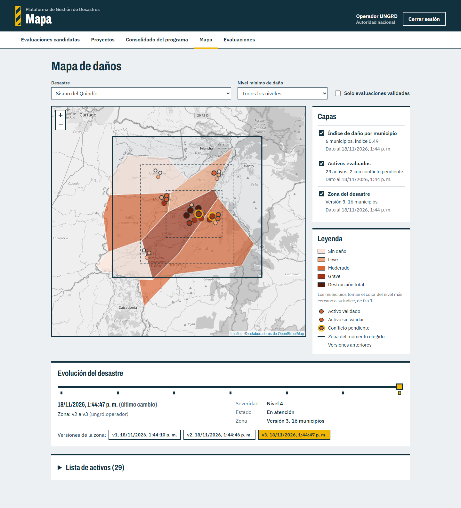
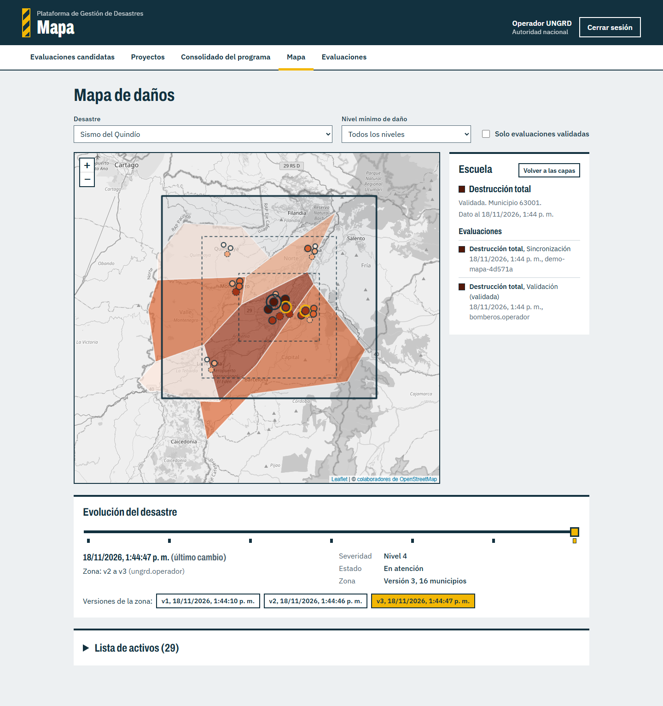
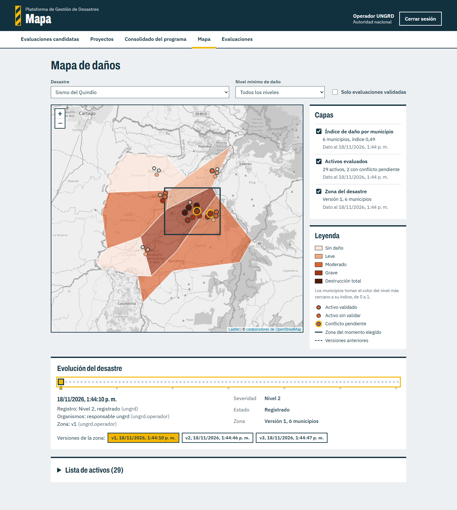
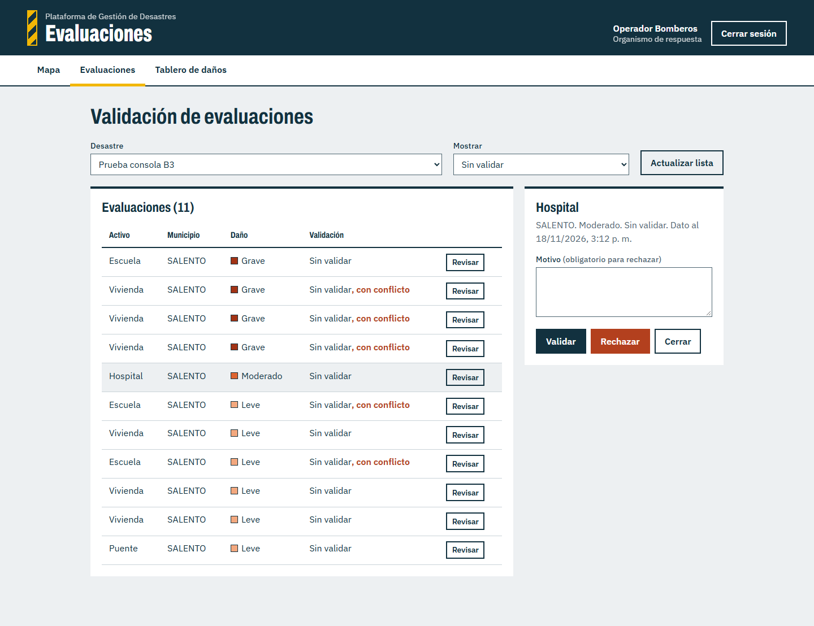
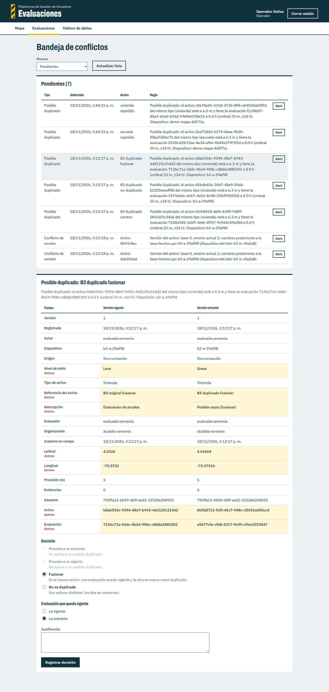
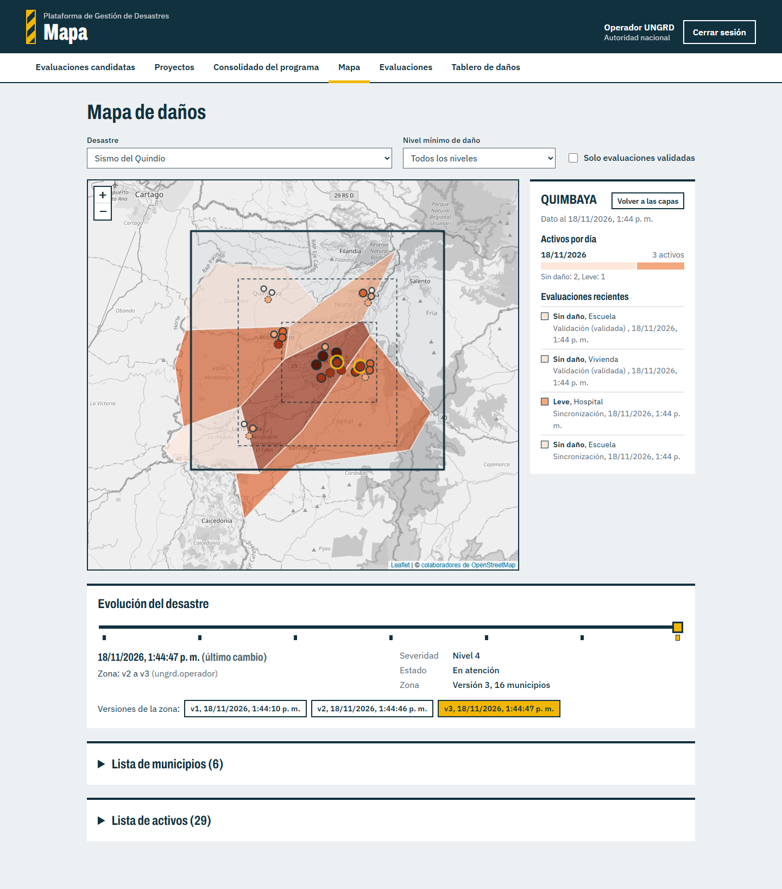

# Consola de coordinación (Angular)

Una sola consola para los actores de la plataforma (DA-13). Se entra con el usuario de Keycloak y cada persona ve las
secciones que permiten los roles de su token. Se sirve con nginx **detrás del API Gateway**: consola y API entran por
http://localhost:8080.

## Inicio de sesión

- OIDC con código y **PKCE S256** contra Keycloak: realm `plataforma`, cliente `consola`, emisor
  `http://localhost:8180/realms/plataforma` (`angular-auth-oidc-client`, DT-12).
- El interceptor (`nucleo/autenticacion/interceptor.ts`) agrega `Authorization: Bearer` a las peticiones de `/v1`. Renueva
  el token si está por vencer; ante un 401 renueva y repite la petición una vez. Si no puede, vuelve a la pantalla de
  ingreso y, al entrar de nuevo, regresa a donde estaba el usuario.
- Ante un 403 o un 404, la pantalla muestra el mensaje del servicio.
- Las guardas y el menú son comodidad de la interfaz: quien autoriza es el gateway y cada servicio.
- La pantalla donde se escribe la clave es de Keycloak y usa el tema `despliegue/keycloak/temas/plataforma`, con la misma
  paleta y tipografías de esta consola. Si cambia `src/styles.css`, actualice también su `plataforma.css`.

Los usuarios de prueba están en `docs/encargos/convenciones.md` (clave: usuario + `_local`).

## Módulos (carga diferida)

| Ruta | Módulo | Roles | Estado |
|---|---|---|---|
| `/reconstruccion` | Candidatas, proyectos y consolidado | `autoridad`, `responsable-proyecto`, `auditor` | Listo |
| `/mapa` | Mapa de daños y desastres | todos menos `evaluador` | Listo |
| `/evaluaciones` | Validación, bandeja de conflictos y catálogo | `autoridad`, `organismo`, `operador`, `administrador` | Listo |
| `/tablero-danos` | Tablero de daños | `autoridad`, `organismo`, `operador`, `auditor` | Enlace: es Razor Pages en Consulta de Daños (E-41) |

El menú se declara en `nucleo/menu.ts`. Un módulo nuevo es una entrada allí y una ruta en `app.routes.ts`.

## Mapa

Leaflet con el mapa base de OpenStreetMap y tres capas que se encienden y apagan por separado. Se elige el desastre y se
filtra por nivel mínimo de daño y por evaluaciones validadas.

| Capa | Qué muestra | Ruta |
|---|---|---|
| Índice de daño por municipio | Coropleta con el índice de 0 a 1; al pasar el cursor, activos, niveles y conflictos | `GET /v1/consulta-danos/mapa?desastre=&nivelMinimo=&soloValidadas=&puntos=true` |
| Activos evaluados | Un punto por activo: el color y el tamaño dicen el nivel, el borde continuo que está validado, el punteado que no, y el anillo amarillo que tiene un conflicto pendiente | La misma ruta |
| Zona del desastre | La zona del momento elegido con línea gruesa y sus versiones anteriores punteadas | `GET /v1/consulta/mapa?soloActivos=false` y `GET /v1/consulta/desastres/{id}/evolucion?en=` |

- Cada capa muestra su `datoAl`. Si la respuesta trae `degradado: true` o `X-Degradado: true`, un aviso dice que es la
  última conocida.
- La barra de tiempo tiene una parada por cada instante en que cambió el desastre, se maneja con el teclado y consulta el
  estado de ese momento al soltarla. Los botones de versión llevan al momento en que cada zona entró en vigor.
- Al hacer clic en un activo se abre su evolución (`GET /v1/consulta-danos/activos/{id}/evolucion`). La lista de activos,
  debajo del mapa, abre lo mismo sin usar el ratón.
- Al hacer clic en un municipio se abre su evolución en el desastre elegido, con los activos por nivel en cada día
  (`GET /v1/consulta-danos/zonas/{codigo}/evolucion?desastre=`). La lista de municipios abre lo mismo con el teclado.
- Leaflet queda detrás de `LienzoMapa` (`modulos/mapa/lienzo-mapa.ts`); las pruebas de componentes usan un lienzo falso.
- Las teselas son del servidor público de OpenStreetMap y llevan su atribución. Ese servidor tiene una
  [política de uso](https://operations.osmfoundation.org/policies/tiles/) pensada para tráfico bajo: un despliegue real
  necesita su propio proveedor.

Las tres capas encendidas:



Evolución de un activo:



La barra de tiempo en la primera versión de la zona:



## Evaluaciones

Cada usuario entra al apartado que permiten los roles de su token. Ante un 403 o un 422 se muestra el mensaje del servicio.
El consolidado y el indicador de la bandeja están en el [Tablero de daños](../servicios/consulta-danos/README.md).

| Apartado | Rol | Qué hace | Rutas |
|---|---|---|---|
| Validación | `autoridad`, `organismo` | Valida una evaluación, la rechaza con motivo o la devuelve a pendiente | `POST /v1/evaluaciones/{id}/validacion` |
| Bandeja de conflictos | `operador` | Compara las dos versiones campo por campo y registra una de las cuatro decisiones con su justificación. Al fusionar se elige cuál queda vigente | `GET /v1/conflictos?estado=`, `POST /v1/conflictos/{id}/resolucion` |
| Tipos de activo | `administrador` | Crea y edita los tipos, con un criterio por nivel de daño | `GET`, `POST` y `PATCH /v1/catalogos/tipos-activo` |

Evaluación de Daños no lista evaluaciones por desastre, así que la lista de validación sale del modelo de lectura del mapa
(`GET /v1/consulta-danos/mapa?puntos=true`). Ese modelo no incluye las evaluaciones rechazadas y se actualiza por eventos: la
pantalla refleja cada decisión de inmediato y vuelve a consultar poco después.







## Compilar y probar

Requiere Node 22.22.3 o superior, o 24.15 o superior.

```bash
npm ci
npx ng build
npx ng test --watch=false
```

El cliente `consola` de Keycloak admite como dirección de regreso `http://localhost:8080` (compose),
`http://localhost:30080` (k8s) y `http://localhost:4200` (`npm start`, que envía `/v1` al gateway).

Para ver los cambios en la plataforma, reconstruya solo la consola:

```bash
docker compose -f despliegue/compose/docker-compose.yml -p plataforma up -d --build --no-deps web
```
