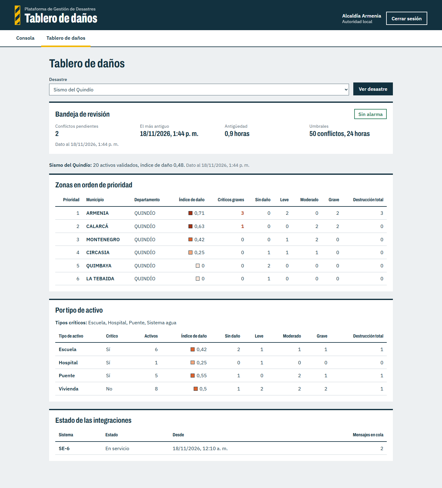

# Servicio Consulta de Daños

Modelo de lectura de la evaluación de daños (DA-08, AD-34): el mapa de daños por zona, el consolidado con la
priorización, la evolución de un activo o de una zona, los indicadores de la bandeja de revisión (R-08) y el tablero de
daños en Razor Pages. Es la ruta de lectura de
mayor volumen del módulo y está separada de la sincronización (párrafo del CU-3 del SAD): se escala sola, sin escalar a
Evaluación de Daños (AD-18, QA-05). No lee el almacén de Evaluación de Daños (AD-01): todo llega por eventos.

Para ejecutar la plataforma, vea el [README de la raíz](../../README.md). La imagen corre como servicio (sin argumentos)
o como migrador (`migrar`, DT-19).

## Estructura (arquitectura limpia y hexagonal, AD-08)

| Carpeta | Anillo | Contenido |
|---|---|---|
| `src/ConsultaDanos.Dominio` | Entidades y reglas | Niveles y `Distribucion`, `IndiceDano`, `Priorizacion`, `EstadoActivo` (reglas de versión de cada aspecto) y `Consolidacion` (incrementos del consolidado), `IndicadoresRevision`, `CodigoZona` y `Departamentos`. Sin paquetes. |
| `src/ConsultaDanos.Aplicacion` | Casos de uso y puertos | `ActualizarProyecciones` (un método por hecho del bus), `ConsultarMapa`, `ConsultarConsolidado`, `ConsultarEvolucion`, `ConsultarEvolucionZona`, `ConsultarIndicadores`; puertos `IAlmacenProyecciones`, `ILecturasDanos`, `ICacheDanos`, `IInvalidacionMapa`, `IFormatoDanos`. Sin paquetes y sin conocer el bus. |
| `src/ConsultaDanos.Infraestructura` | Adaptadores | EF Core con PostGIS y su migración, `AlmacenProyeccionesPostgis` (SQL con bloqueos en orden fijo), `LecturasPostgis`, `CacheRedis`, `InterceptorInvalidacion`, `FormatoJson` (GeoJSON), `ManejadorEventosConsultaDanos` (sobre → hecho). Usa `comun/`. |
| `src/ConsultaDanos.Api` | Adaptadores de entrada | `Program.cs`: rutas de la API, identidad con `IIdentidadActual`, parámetros de despliegue. `Pages/` y `Tablero/`: el tablero Razor con su sesión. |
| `tests/ConsultaDanos.Pruebas` | | Índice, priorización, reglas de versión, todos los órdenes de llegada (en memoria), caché y degradación con puertos en memoria, arquitectura. |
| `tests/ConsultaDanos.Integracion` | | PostGIS, Redis y RabbitMQ reales (Testcontainers) con `despliegue/bus/definiciones.json`. |

## Dónde está cada parte del diseño

| Diseño | Código |
|---|---|
| Proyecciones alimentadas por EV-08, 09, 10, 21, 22, 23, 25 y 26 (DA-08, AD-34, E-03, E-05, E-06, E-13, E-16) | `Infraestructura/ManejadorEventos.cs` → `Aplicacion/ActualizarProyecciones.cs` |
| `p_evaluacion_vigente`: activo con nivel, tipo, municipio, desastre, validación, conflicto y punto | Tabla `p_evaluacion_vigente` (`geometry(Point,4326)`); reglas en `Dominio/Activo.cs` (`EstadoActivo`) |
| Tolerancia al desorden y a la repetición (dos réplicas en la misma cola) | Contenido protegido por la versión del activo y desempatado por el origen (`OrigenContenido`); validación protegida por la versión de la evaluación (`p_validaciones`); conflictos que se completan en cualquier orden (`p_conflictos`); idempotencia del consumidor (`mensajes_procesados`) |
| `p_dano_por_zona`, solo validadas (RF-ED-10) | `Consolidacion.Deltas`: -1 en el grupo donde contaba, +1 donde cuenta; `AlmacenProyeccionesPostgis.GuardarActivosAsync` |
| Índice de daño de la zona (DA-08, P-05) | `Dominio/Dano.cs` (`IndiceDano`: pesos 0, 0,25, 0,5, 0,75 y 1, ponderados por cantidad) |
| Priorización (DA-08, P-05) | `Dominio/Priorizacion.cs`; tipos críticos en `ConsultaDanos:TiposCriticos` |
| `p_historial_activo` y evolución de un activo o una zona (RF-ED-15, E-40) | Tabla de solo inserción; `LecturasPostgis.EvolucionAsync` y `HistorialZonaAsync`; `ConsultarEvolucionZona` valida la zona y agrega por día |
| `p_bandeja` y alarma de R-08 (DA-09, E-09, E-13) | `RecalcularBandejaAsync` bajo el bloqueo de la fila; `Dominio/Revision.cs`; umbrales `ConsultaDanos:UmbralConflictos` y `ConsultaDanos:UmbralHoras` |
| Capa de municipios simplificada al proyectar (EV-21, AD-17) | `AlmacenProyeccionesPostgis.GuardarCapaAsync` (`ST_SimplifyPreserveTopology`, ~50 m) |
| Nombres de tipos (EV-25) y estado de integraciones (EV-23, R-10) | `p_tipos_activo`, `p_integraciones`; salen en el consolidado |
| Caché de geometrías `geo:{capa}:{version}:{codigo}` (DA-08, E-21) | `ConsultarMapa.GeometriasAsync`, `CacheRedis` (prefijo `consulta-danos:`) |
| Mapa armado con TTL corto e invalidado por desastre | Clave `mapa:{desastre}:g{global}.v{desastre}:{filtros}`; `InterceptorInvalidacion` sube la versión al confirmar la transacción |
| Degradación (CON-6, AD-16) | `Aplicacion/Consultas.cs` (`LecturaConCache`): sin Redis se arma desde PostGIS; sin PostGIS se sirve la última con `degradado: true`; `SaludCache` informa *Degraded* |
| `datoAl` en toda respuesta (AD-16) | `p_desastres.dato_al` (último evento aplicado que cambió el desastre), la capa del mapa, el historial y `p_bandeja.dato_al` |
| Mínimo privilegio (DT-02, AD-41) | Migración `Inicial`: `SELECT, INSERT, UPDATE` en las proyecciones; `SELECT, INSERT` en `p_historial_activo` y `mensajes_procesados`; ningún `DELETE` |
| Migrador (DT-19) | `Infraestructura/Registro.cs` (`MigracionConsultaDanos`) |

## Rutas

Todas exigen identidad (401 sin ella) y cualquier usuario autenticado consulta. Toda respuesta lleva `datoAl`; el mapa y
el consolidado llevan además `degradado` (y el encabezado `X-Degradado`).

| Método | Ruta | Notas |
|---|---|---|
| GET | `/v1/consulta-danos/mapa?desastre=&nivelMinimo=&soloValidadas=&puntos=` | GeoJSON (`application/geo+json`). Una feature `tipo: "zona"` por municipio con `activos`, `indiceDano`, `distribucion` y `conConflicto`; con `puntos=true`, una `tipo: "activo"` por activo con `nivelDano`, `validada`, `estadoValidacion` y `conflictoPendiente`. `desastre` es obligatorio. `soloValidadas` por omisión `false` (todas menos las rechazadas). Los filtros se aplican a la coropleta y a los puntos |
| GET | `/v1/consulta-danos/consolidado?desastre=` | Impacto por zona y por tipo (solo validadas), `zonas` en el orden de la priorización (`prioridad`, `criticosGraves`, `indiceDano`), `porTipo`, `tiposCriticos` e `integraciones` |
| GET | `/v1/consulta-danos/activos/{id}/evolucion` | `vigente` y `evaluaciones` (sincronización, actualización, asociación, resolución y validación) en orden de tiempo. 404 si no hay nada del activo |
| GET | `/v1/consulta-danos/zonas/{codigo}/evolucion?desastre=` | `codigo`: DIVIPOLA de 5 dígitos (municipio) o 2 (departamento), validado contra la capa de municipios; `desastre` es opcional. Devuelve `zona` (`codigo`, `nombre`, `tipo`), `datoAl`, `evaluaciones` en orden de tiempo (activo, tipo, nivel, origen, estado de validación, autor) y `porDia` (`fecha` en hora de Colombia, `activos`, `distribucion`). En `porDia` cada activo cuenta una vez, en su último nivel del día, sin evaluaciones rechazadas. 400 si el código o el desastre no son válidos; 404 si la zona no está en la capa o no tiene evaluaciones |
| GET | `/v1/consulta-danos/indicadores-revision` | `conflictosPendientes`, `masViejoDesde`, `antiguedadHoras`, umbrales, `superaTamano`, `superaAntiguedad`, `alarma` |
| GET | `/tablero-danos?desastre=` | Página Razor con sesión propia (no usa el JWT de la API). Ver "Tablero de daños" |
| GET | `/salud/vivo`, `/salud/listo` | La caché caída deja `listo` en *Degraded* (200) |

Errores: `{ "codigo", "mensaje" }`. 400 parámetro inválido, 401 sin identidad, 404 no existe, 503 ni la base ni la caché
pueden responder.

## Tablero de daños (Razor Pages)

`/tablero-danos` muestra el consolidado con la priorización y el indicador de la bandeja de revisión: selector de
desastre, alarma, zonas en orden de prioridad, resumen por tipo de activo, tipos críticos, integraciones, `datoAl` y un
aviso si la respuesta llega degradada. El curso pide una pantalla en Razor Pages, y esta es esa excepción a la consola
única de DA-13 (E-41).

**La misma lógica con dos interfaces.** Las páginas son un segundo adaptador de entrada dentro de `ConsultaDanos.Api`.
`Pages/TableroDanos/Index.cshtml.cs` recibe por inyección `ConsultarConsolidado` y `ConsultarIndicadores`, los mismos casos
de uso que atienden `/v1/consulta-danos/consolidado` y `/v1/consulta-danos/indicadores-revision`, y los llama en el mismo
proceso, sin HTTP a su propia API. Dominio y Aplicación no cambiaron: priorización, caché y degradación son una sola, y
solo varía cómo se presenta el resultado.

| Parte | Dónde | Notas |
|---|---|---|
| Páginas y diseño | `Pages/TableroDanos`, `Pages/Shared/_Tablero.cshtml` | HTML servido por el servidor; funciona sin JavaScript y con teclado |
| Estilos y fuentes | `wwwroot/tablero-danos` | Paleta, cabecera y tipografías de la consola, sin frameworks CSS |
| Sesión | `Tablero/RegistroTablero.cs` | OpenID Connect con PKCE y cookie `tablero-danos`, limitada a esta ruta |
| Lista de desastres | `Tablero/DirectorioDesastres.cs` | El nombre es del servicio Consulta: se lee por la red interna con la cuenta de servicio del cliente |

**Inicio de sesión.** Cliente confidencial `consulta-danos-tablero` del realm `plataforma`. Lo ven `autoridad`, `organismo`,
`operador` y `auditor`; otro rol va a `/tablero-danos/sin-acceso`. Quien ya entró a la consola no vuelve a escribir la clave,
por el inicio de sesión único de Keycloak.

- El emisor es `http://localhost:8180`, que no existe dentro de los contenedores. Como `Plataforma.Comun.Seguridad`, el
  servicio lee los metadatos en `http://keycloak:8080`. Con `KC_HOSTNAME_BACKCHANNEL_DYNAMIC`, esos metadatos llevan al
  navegador a `localhost:8180` y al servidor a `keycloak:8080`, sin reescribir ningún endpoint.
- El gateway deja pasar la ruta sin token (`roles: publico`, solo `GET`): el navegador no manda un Bearer y la autorización
  la hace esta página con su cookie. Por eso el regreso de Keycloak usa `response_mode=query`.
- Las dos réplicas comparten en Redis las llaves que protegen la cookie. Si Redis las pierde, la sesión se rehace con el
  inicio de sesión único.
- El cliente se agrega a un Keycloak en marcha con `POST /admin/realms/plataforma/partialImport`, con el cliente y su
  usuario `service-account-consulta-danos-tablero`. No hay que recrear Keycloak, porque cambiarían sus llaves de firma.

Con `alcaldia.armenia`, que entró antes a la consola:



Con `auditor.1`:


## Decisiones que conviene conocer

- **EV-09 en conflicto no reemplaza la vigente.** Si la regla de conflicto no aplicó la entrante, EV-09 trae su
  contenido con la versión del activo que ya estaba. A igual versión gana el origen de más rango: resolución (EV-22) >
  evaluación aplicada (EV-09, EV-26) > sincronización en conflicto > copia de EV-08. Así el resultado no depende del orden.
- **EV-08 antes que la evaluación.** Su copia del contenido se usa con versión 0 hasta que llega EV-09.
- **El consolidado se ajusta por incrementos** bajo el bloqueo de cada activo. Los bloqueos se toman siempre en el mismo
  orden (bandeja, activos, consolidado, desastres) para que dos réplicas no se interbloqueen.
- **La marca de conflicto se calcula al consultar** (`p_conflictos` con estado pendiente), porque EV-10 y EV-22 pueden
  llegar en cualquier orden. Al fusionar un duplicado (E-14), su activo deja de contar en el mapa y en el consolidado.
- **La invalidación de la caché se aplica al confirmar** la transacción del consumidor (interceptor de EF Core). Si se
  hiciera antes, una consulta concurrente podría guardar el mapa viejo con la versión nueva.
- **Redis con `FailFast`**: con la caché caída cada operación falla en el acto y el mapa se arma desde la base sin sumar
  esperas.

## Probar

```bash
bash herramientas/dotnet.sh test servicios/consulta-danos/tests/ConsultaDanos.Pruebas
bash herramientas/dotnet.sh test servicios/consulta-danos/tests/ConsultaDanos.Integracion
```
